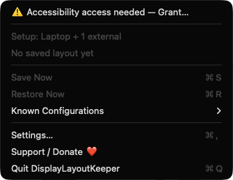
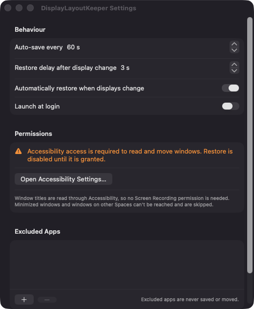

# DisplayLayoutKeeper

**🌐 Website:** [turhe123.github.io/display-layout-keeper](https://turhe123.github.io/display-layout-keeper/)

Remembers where your windows sit for each monitor setup and restores them when displays change.

> 🆓 A free, open-source **Stay alternative** for macOS 14+. Native Swift, no accounts, no subscriptions, MIT licensed.


## Why

Plug in a dock, unplug a monitor, or wake your Mac from sleep, and macOS often scrambles your windows. DisplayLayoutKeeper is a free, open-source, 100% native, backend-free alternative to paid utilities in the *Window Management* category (inspired by tools such as Stay, $15 one-time). It runs entirely on your Mac, with no accounts, servers or telemetry.

## Features

- **Per-setup layouts**: each monitor arrangement gets its own signature, built from every display's UUID, pixel size and origin. Layouts survive port changes.
- **Automatic snapshots**: saves all visible, standard windows (app bundle ID, title, frame) every 60 seconds by default (10–600 s). It only saves once the setup has been stable for 5 seconds, and it also saves just before sleep.
- **Automatic restore**: when the display configuration changes and a saved layout exists for the new setup, windows are moved back after a configurable delay (default 3 s, 0–30 s). It waits for displays to settle after wake.
- **Smart matching**: windows are matched by bundle ID plus exact title, then by bundle ID plus window index (useful for browser tabs whose titles change).
- **Safe placement**: restored frames are clamped onto the nearest connected display.
- **Menu bar app**: shows the current setup, the last snapshot time and window count, **Save Now** (⌘S), **Restore Now** (⌘R), and a **Known Configurations** submenu with per-layout delete. When no layout exists, it says "No saved layout yet" and Restore Now is disabled.
- **Excluded apps**: pick apps in `/Applications` that are never saved or moved.
- **Launch at login** via `SMAppService`.
- **Notification** confirming an automatic restore (requested only when first needed).
- **Local storage**: one JSON file per configuration in Application Support, capped at 20 configurations.
- **Permission warning**: if Accessibility access is missing or revoked, the menu shows a warning row and restore is disabled.

Limitations: minimized windows and windows on other Spaces can't be reached through Accessibility and are skipped.

## Screenshots

<p align="center"></p>

<p align="center"><em>The menu bar menu shows the current monitor setup, the saved-layout status, Save Now and Restore Now, and the Known Configurations submenu.</em></p>

<p align="center"></p>

<p align="center"><em>Settings let you choose the auto-save interval, the restore delay, automatic restore, launch at login, and apps to exclude, and they show the Accessibility permission status.</em></p>

## Install

1. Download `DisplayLayoutKeeper-macOS.zip` from the [latest release](https://github.com/turhe123/display-layout-keeper/releases/latest).
2. Unzip it and move `DisplayLayoutKeeper.app` to `/Applications`.
3. The app is open source and not notarized, so remove the quarantine attribute:

   ```bash
   xattr -cr /Applications/DisplayLayoutKeeper.app
   ```

4. Right-click the app → **Open** the first time.

## Build from source

Requires macOS 14+ and Xcode with Swift 5.9+.

```bash
brew install xcodegen
xcodegen generate
xcodebuild -project DisplayLayoutKeeper.xcodeproj -scheme DisplayLayoutKeeper -configuration Release -derivedDataPath ./build build
```

The app is produced at `build/Build/Products/Release/DisplayLayoutKeeper.app`.

## Permissions

- **Accessibility** (required): used to read window titles, positions and sizes of other apps, and to move and resize them on restore. The app prompts for it at launch and can open the right System Settings pane from the menu or Settings.
- **Notifications** (optional): used only to show a short "Layout restored" message after an automatic restore.
- **Screen Recording**: not requested. Window titles are read through Accessibility instead.
- **Microphone, Camera, Contacts, etc.**: not requested.

## Built with AI

DisplayLayoutKeeper was written by [Claude Code](https://claude.com/claude-code) inside an automated pipeline, from a plain-English spec. No code, binaries or assets from any commercial app were used; it is a clean-room reimplementation of a feature set, not a copy.

What that means in practice:

- The full source is in this repo under the MIT license. Read it before you run it.
- No network calls, no analytics, no third-party dependencies. Only Apple frameworks.
- Ad-hoc signed and not notarized, which is why Gatekeeper warns on first launch.
- It has had less human review than a hand-written app. Bug reports and pull requests are welcome.

## Support ❤️

DisplayLayoutKeeper is free. If it saves you some headaches, you can support its development:

[%20Davidai%20%E2%9D%A4%EF%B8%8F-ff5e5b?logo=ko-fi&logoColor=white)](https://ko-fi.com/leodavidai)

[Support Or (Leo) Davidai ❤️](https://ko-fi.com/leodavidai)

## More free Mac apps

DisplayLayoutKeeper is one of a growing collection of [free, open-source Mac utilities](https://github.com/turhe123/mac-apps) built the same way: native Swift, no accounts, no telemetry. Browse the full gallery at [turhe123.github.io/mac-apps](https://turhe123.github.io/mac-apps/).

Prefer something that runs in the browser? The same pipeline builds [free, private web tools](https://turhe123.github.io/web-tools/): PDF, image, developer, data and audio tools, nothing uploaded.

## License

MIT © Or Davidai Bachar
